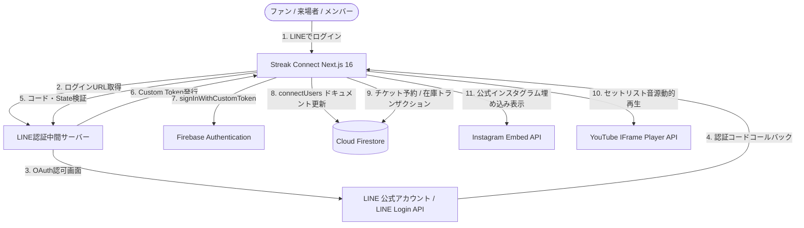

# これはあなたが知っているNext.jsではありません

このバージョンには破壊的変更が含まれています。API、コンベンション、およびファイル構造はすべて、あなたの学習データと異なる場合があります。コードを記述する前に、`node_modules/next/dist/docs/` にある関連ガイドを必ず読んでください。非推奨の警告には厳格に従ってください。

# Agent Behavior Rules
1. **実装プランの承認プロセス省略**: Implementation Plan（実装プラン）を作成した後、ユーザーの明示的な承認を待つ必要はありません。プランを提示（または作成）したら、そのまま連続してタスクの実行（コードの修正等）に進んでください。
2. **モバイル向けUI設計の徹底**: スマートフォンでの表示崩れを防ぐため、ボタン、入力欄、チケットカード等のUI要素が画面幅で見切れたり不自然に折り返したりしないように常に設計に配慮してください。モバイルファーストでの実装を徹底してください。
3. **PCシステムおよびネットワーク操作の絶対禁止**: PC本体のシステム設定、ハードウェア構成、またはネットワーク状態を変更するコマンドの実行やアクションは絶対に禁止します。タスクの解釈ミスによってホストシステムを変更すると、システムエラーを引き起こします。
   - `netsh`、`ipconfig /renew`、`ifconfig`、`systemctl restart network` などのネットワークアダプター、Wi-Fi設定、ファイアウォール構成を無効化、リセット、または変更するコマンドは**絶対に実行しないでください**。
   - ハードウェアドライバーのアンインストール、再インストール、アップデートは**絶対に行わないでください**。
   - プロジェクトディレクトリ外のOSレベルのシステムファイルの変更、システム全体の再起動やシャットダウンは**絶対に実行しないでください**。
   - 通信エラーやAPIエラーが発生した場合は、ホストマシンの設定を変更するのではなく、プロジェクト内のアプリケーションコードや設定を修正するか、ユーザーに指示を仰いでください。
4. **自動ビルド検証**: ユーザーの指示に基づいてコードを修正した後は、必ず自動的に `npm run build` を実行してビルドエラーがないか確認してください。もしエラーが発生した場合は、ユーザーに報告する前に**必ず自らエラーを解消し、再度ビルドが通ることを確認**してから完了報告を行うこと。
5. **Firestoreルールの自動更新**: 新機能の追加、新しいコレクションやサブコレクションの導入、あるいは既存コレクションのアクセス要件変更が発生した際は、必ず `firestore.rules` もセットで確認・更新してください。クライアントSDKからの読み取り・書き込み権限を過不足なく定義し、本番環境での Permission Denied エラーやセキュリティホールを未然に防止すること。
6. **仕様書 (`SPECIFICATION.md`) の継続的更新**: 機能の追加・修正、UI/UXの改修、権限・仕様の変更、あるいはデータモデルの追加・変更など、アプリケーションに修正を加えた際は、必ずその都度 `SPECIFICATION.md` も同期して更新・改変してください。実装と設計書が常に一致した最新状態を維持すること。
7. **navigateやscratchpadの使用禁止**: ブラウザの自動操作（navigate）や scratchpad は動作が不安定になるため使用しないでください。

---

# STREAK CONNECT (SSJO Connect) プロジェクト完全仕様・再現設計書

本ドキュメントは、Swing Streak Jazz Orchestra（SSJO）のファン・来場者・ゲスト向け公式ポータル兼デジタルチケット予約管理システム「**Streak Connect**」の全容、設計思想、アーキテクチャ、技術的工夫、およびゼロから完全に再構築・再現するための実装仕様を網羅的に記録したものである。

---

## 1. プロジェクト基本概要

### 1.1. システムの目的
「Streak Connect」は、社会人ビッグバンド（Swing Streak Jazz Orchestra）のファン・来場者・ゲストに向けて、ライブ公演情報、デジタルチケット予約・入場受付、オンラインアンケート回答、バンド公式メディア（Instagram/YouTube）および公式ストア連携を一元提供するWebポータルである。
スマートフォンからの利用に特化したスタイリッシュなダークテーマ（黒×深紅 `#e7211a`×白）を採用し、LINEログインを活用したストレスフリーな認証体験とデジタルチケットQR発券を実現している。

### 1.2. 主要技術スタック
| カテゴリ | 採用技術 | バージョン/詳細 |
| :--- | :--- | :--- |
| **Framework** | Next.js (App Router, Turbopack) | `16.1.6` |
| **UI Library** | React / React DOM | `19.2.3` |
| **Language** | TypeScript | `^5` (Strict モード運用) |
| **BaaS / Database** | Firebase SDK / Cloud Firestore / Firebase Authentication | `^12.8.0` |
| **外部連携 (LINE)** | LINE Login API v2.1 (OAuth 2.0 / Custom Token認証) | 認証サーバー経由でのトークン交換・プロファイル同期 |
| **QRコード発券** | `qrcode.react` (`QRCodeSVG`) | `^4.2.0` (デジタルチケットQRコード動的生成) |
| **Styling** | CSS Modules + Tailwind CSS v4 | 各機能ごとの `*.module.css` 運用、styled-jsx全廃 |
| **Icons / Assets** | Font Awesome 6 (Solid / Brands) | 全タイトル（`h1`含む）・アクションのアイコン統一 |

---

## 2. 全体アーキテクチャ (Core Architecture)

### 2.1. Feature-based Architecture (機能別垂直分割)
機能単位でロジックとUIを完全カプセル化し、保守性と再利用性を最大化する。

```
src/
├── app/                          # ルーティング定義 (薄い Server Component)
│   ├── page.tsx                  # ルートアクセス時の /home 転送
│   ├── layout.tsx                # ルートレイアウト (Metadata, viewport, FontAwesome)
│   ├── ClientLayout.tsx          # クライアントシェル (AuthProvider, Breadcrumbs, Dialog, Preview, Script)
│   ├── globals.css               # グローバル基本スタイル (ダークテーマ土台, 共通トークン)
│   ├── home/page.tsx             # ホーム画面 (ライブ一覧, メディア, メンバー, グッズ, 写真)
│   ├── live-detail/[id]/page.tsx # ライブ詳細画面 (フライヤー, 会場, 料金, セットリスト音源)
│   ├── ticket-reserve/[id]/page.tsx # チケット予約画面 (一般予約, 招待グループ予約, 在庫制御)
│   ├── ticket-detail/[id]/page.tsx  # チケット詳細画面 (QRコード, 予約番号, URL共有)
│   ├── enquete-answer/[id]/page.tsx # 来場者アンケート回答画面 (動的設問, 星評価)
│   ├── mypage/page.tsx           # マイページ (プロフィール, 予約済みチケット一覧, 退会)
│   ├── about/page.tsx            # サイト情報画面 (タブ切り替え: 目的, 予約規定, 免責, 個人情報)
│   ├── agreement/page.tsx        # 利用規約画面 (初回同意チェック, Firestore更新)
│   └── callback/page.tsx         # LINEログインコールバック画面 (カスタムトークンログイン)
├── features/                     # 機能ごとの垂直スライス
│   ├── home/                     # ホーム機能
│   │   ├── views/HomeClient.tsx  # メインビュー & home.module.css
│   │   └── components/LiveCard.tsx # ライブカードコンポーネント
│   ├── live/                     # ライブ詳細機能
│   │   ├── views/LiveDetailClient.tsx # ライブ詳細ビュー & live-detail.module.css
│   │   └── api/live-client-service.ts # Firestore読み取りサービス
│   ├── ticket/                   # チケット予約・詳細機能
│   │   ├── views/TicketReserveClient.tsx # 予約ビュー & ticket-reserve.module.css
│   │   ├── views/TicketDetailClient.tsx  # 詳細ビュー & ticket-detail.module.css
│   │   ├── api/ticket-client-service.ts  # 在庫トランザクション・チケット操作
│   │   └── types/ticket.ts       # チケットデータ型定義
│   ├── enquete/                  # アンケート機能
│   │   ├── views/EnqueteAnswerClient.tsx # アンケート回答ビュー & enquete-answer.module.css
│   │   └── api/enquete-client-service.ts # 設問取得・回答送信サービス
│   ├── mypage/                   # マイページ機能
│   │   ├── views/MyPageClient.tsx # マイページビュー & mypage.module.css
│   │   ├── components/TicketCard.tsx # マイチケットカードコンポーネント
│   │   └── api/mypage-client-service.ts # マイチケット取得サービス
│   ├── about/                    # サイト情報機能
│   │   └── views/AboutClient.tsx # サイト情報ビュー & about.module.css
│   ├── agreement/                # 利用規約機能
│   │   └── views/AgreementClient.tsx # 利用規約同意ビュー & agreement.module.css
│   └── auth/                     # 認証コールバック機能
│       ├── views/CallbackClient.tsx # コールバックビュー & callback.module.css
│       └── api/auth-client-service.ts # LINE認証・Firebase同期サービス
├── components/                   # アプリ全体共通コンポーネント
│   ├── Header.tsx                # 共通ヘッダー (ナビゲーション, アイコン, LINEログイン誘導)
│   ├── Footer.tsx                # 共通フッター (コピーライト, Instagramリンク, サイト情報)
│   ├── CommonDialog.tsx          # プロミスベース共通ダイアログ (styled-jsx全廃, CSS Modules)
│   ├── ImagePreviewModal.tsx     # 写真拡大プレビューモーダル (CSS Modules)
│   └── YoutubeSetlistPlayer.tsx  # YouTubeセットリスト自動結合プレイヤー (CSS Modules)
├── contexts/                     # AuthContext (LINE/Firebase認証状態), BreadcrumbContext
└── lib/                          # 共通ライブラリ・ユーティリティ
    ├── firebase.ts               # Firebase App / Auth / Firestore 初期化
    ├── functions.ts              # スピナー, セッション, ログ, 日付フォーマット, deleteTicket
    └── firestore/                # 型定義 & ユーティリティ
        ├── types.ts              # ドキュメント型定義集
        ├── utils.ts              # toPlainObject (Timestampシリアライズ)
        └── index.ts              # re-export
```

### 2.2. システム連携構成図 (Mermaid)



---

## 3. 認証・認可アーキテクチャ (LINE Login & User State)

### 3.1. LINE ログイン & Firebase Custom Token 認証フロー
1. **ログイン要求**: ヘッダーの「Login」ボタンまたは予約・マイページ遷移時のインターセプトにより、`globalGetLineLoginUrl` へリクエスト。
2. **戻り先保持**: `redirectAfterLogin` パラメータに現在の URL を付与し、ログイン成功後に元の画面（例: `/ticket-reserve/[id]`）へ自動復帰させる。
3. **中間認証サーバー連携**: 認可コード（`code`）および `state` を受領した `/callback` 画面が `globalLineLoginUrl`（POST）を呼び出し、LINE プロフィール情報と Firebase Custom Token を取得。
4. **Firebase サインイン**: `signInWithCustomToken(auth, customToken)` によりセキュアにサインインを完了。
5. **ユーザー同期 (`connectUsers`)**: Firestore の `connectUsers/{uid}` ドキュメントに `displayName`, `pictureUrl`, `lastLoginAt` を `merge: true` で自動保存。
6. **利用規約判定**: `agreedAt` が未設定のユーザーは自動的に `/agreement` へリダイレクトし、規約同意を必須化。

---

## 4. 技術的な工夫・特筆すべき実装パターン (Innovations & Best Practices)

### 4.1. チケット在庫の厳密なトランザクション制御 (`runTransaction`)
- ライブチケットの予約・変更・取消は、Cloud Firestore の `runTransaction` を用いてアトミックに実行。
- 複数ユーザーによる同時予約時でも、残席数（`ticketStock - totalReserved`）をリアルタイムに排他チェックし、オーバーブッキングを完全に防止。
- 予約取消時（`deleteTicket`）は返却人数分を安全に `totalReserved` から減算（0未満にならないガード付き）。

### 4.2. 一般予約とメンバー招待予約のハイブリッド発番アーキテクチャ
- **一般予約 (`resType === "general"`)**:
  - 代表者氏名＋複数同伴者名を登録。
  - 4桁のランダム数字文字列（`Math.floor(1000 + Math.random() * 9000).toString()`）を予約番号として自動発番。
- **招待予約 (`resType === "invite"`)**:
  - 楽団メンバー専用の予約モード（Firestore `users/{uid}` の存在で自動判定）。
  - 「家族」「職場」「大学ジャズ研」など、グループ別に複数人をまとめて登録可能。
  - 発番体系は「4桁親番号-枝番（`5821-1`, `5821-2`...）」。
  - グループ専用の個別招待URL（`?g=1`, `?g=2`）を発行でき、グループごとの独立したQRコードを個別来場者に共有可能。

### 4.3. YouTube セットリストプレイヤーの動的音源結合
- ライブ情報に含まれる `live.setlist` の `songIds` を取得し、`scores` コレクションから `referenceTrack`（YouTube URL）を動的照会。
- 抽出した11桁の YouTube ビデオIDを束ね、IFrame プレイヤーおよび公式プレイリストリンク（`https://www.youtube.com/watch_videos?video_ids=...`）を自動生成。
- 来場前・来場後に、公演で演奏される楽曲の参考音源をワンストップで試聴できる。

### 4.4. プロミスベースの共通フィードバックUI (`CommonDialog`)
- `alert()` や `confirm()` の同期ブロッキングを完全禁止。
- React の State 管理と JavaScript Promise を組み合わせた `showDialog(message, isOKOnly, isPrompt)` を提供。
- styled-jsx を完全に排除し、ブランドカラー（漆黒背景、深紅 `#e7211a`、白文字）の CSS Modules でスタイリッシュに描画。

### 4.5. 安全なデータ削除 (論理アーカイブ `archiveAndDeleteDoc`)
- ユーザーが退会する際、登録済みの全チケットをトランザクションで安全に在庫返却・取消。
- ユーザーデータは物理削除する前に `archives/connectUsers_{uid}_{timestamp}` に完全バックアップ退避してから削除を実行。

---

## 5. Firestore コレクション設計 (Data Models)

| コレクション名 | 用途 | 主なフィールド |
| :--- | :--- | :--- |
| `connectUsers` | 顧客・ファンユーザー情報 | `displayName`, `pictureUrl`, `agreedAt`, `status`, `lastLoginAt`, `createdAt` |
| `lives` | ライブ公演情報 | `title`, `date`, `venue`, `open`, `start`, `advance`, `door`, `flyerUrl`, `ticketStock`, `totalReserved`, `isAcceptReserve`, `acceptStartDate`, `acceptEndDate`, `setlist`, `caution`, `note` |
| `tickets` | チケット予約データ | `liveId`, `uid`, `resType` (general/invite), `reservationNo`, `representativeName`, `companions`, `totalCount`, `groups`, `createdAt`, `updatedAt` |
| `configs/enqueteQuestions` | アンケート設問マスタ | `questions` (`id`, `title`, `type`, `required`, `options`) |
| `enqueteAnswers` | 来場者アンケート回答 | `liveId`, `uid`, `common` (設問IDごとの回答値), `submittedAt` |
| `scores` | 楽曲マスタ (セットリスト音源参照用) | `title`, `referenceTrack` (YouTube URL), `youtubeId` |
| `medias` | 公式メディア (Instagram/YouTube) | `title`, `date`, `instagramUrl`, `youtubeUrl`, `isDispTop` |
| `connectLogs` / `connectErrorLogs` | 操作ログ / エラーログ | `uid`, `action`, `dataId`, `status`, `errorDetail`, `createdAt` |
| `archives` | 削除データ履歴退避 | `originalCollection`, `originalId`, `archivedAt`, 退避データ本文 |

---

## 6. 再構築・ゼロから再現するための手順 (Replication Guide)

### 6.1. プロジェクト初期化
```bash
# Next.js 16 + React 19 + TypeScript プロジェクト作成
npx -y create-next-app@latest streak-connect --typescript --eslint --no-tailwind --app --src-dir

# 依存パッケージのインストール
npm install firebase qrcode.react
npm install -D tailwindcss @tailwindcss/postcss postcss
```

### 6.2. 必要な環境変数 (`.env.local`)
```env
# Firebase Client SDK
NEXT_PUBLIC_FIREBASE_API_KEY=AIzaSy...
NEXT_PUBLIC_FIREBASE_AUTH_DOMAIN=your-project.firebaseapp.com
NEXT_PUBLIC_FIREBASE_PROJECT_ID=your-project-id
NEXT_PUBLIC_FIREBASE_STORAGE_BUCKET=your-project.firebasestorage.app
NEXT_PUBLIC_FIREBASE_MESSAGING_SENDER_ID=...
NEXT_PUBLIC_FIREBASE_APP_ID=1:...
NEXT_PUBLIC_FIREBASE_MEASUREMENT_ID=...
```

### 6.3. ビルド・検証手順
```bash
# 型チェックおよび Turbopack による本番ビルド検証
npm run build

# ローカル起動確認
npm run dev
```

---

## 7. まとめ
本プロジェクトは、Swing Streak Jazz Orchestra のファンと楽団を直結する洗練されたゲートウェイとして設計されている。
すべての画面で統一されたダークトーンのデザイン哲学、厳密な在庫トランザクション制御、安全なLINEログイン連携、および Feature-based Architecture に従うことで、保守性が高く堅牢なシステムが維持されている。

